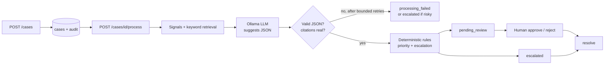

# Customer Operations AI Agent — with Evaluation, Audit and Human Approval

A support-triage service for a **fictional SaaS company (Acme Cloud)**. A customer message comes in through a REST API; the system retrieves relevant policy text, asks a **local LLM (Ollama)** for a structured recommendation, applies **deterministic business rules** to decide priority and escalation, stores everything with a **hash-chained audit log**, and makes a **human** approve anything consequential. A separate **evaluation pipeline** measures how well it all works on a labelled synthetic dataset.

> **Synthetic data only.** No real customers, no real transactions, no real business results. Nothing here has been used in production.

## Status: what is implemented, tested and still open

| Area | Status |
|---|---|
| Case lifecycle, state machine, approval rules, audit chain, rules engine, retrieval, AI output validation, evaluation pipeline | Implemented and covered by **139 passing automated tests** in the build environment (fake models, no Ollama needed) |
| HTTP API (FastAPI) | Implemented. Its tests (`tests/test_api.py`) are written but **were not executed during the build** because FastAPI could not be installed there. **Run `pytest` on your machine first** and fix anything that fails |
| Real-model behaviour (Ollama) | Client tested against a fake HTTP transport only. **No evaluation has been run against a real model yet**; see `docs/evaluation.md` for how, and where to record the result |
| Authentication | A single shared API key. A development placeholder, **not** real authentication |
| Deployment | Local only. No hosted deployment, no Docker image |

"Production-ready" this is not. See [Known limitations](#known-limitations) and `docs/security.md`.

## How a case flows



Three principles run through the design:

1. **The AI suggests; rules decide; humans approve.** The model can only recommend one of six actions. It cannot approve, refund, unlock or resolve anything. The statuses `approved`, `rejected` and `resolved` can only be set by the human endpoints, and that is checked on the server.
2. **Untrusted input is data.** Customer text is wrapped in delimiter tags and never mixed into instructions; look-alike tags are stripped; and keyword rules independently escalate injection attempts even if a model obeys them.
3. **Everything is recorded.** Every AI run, rule decision, human action and *refused* action becomes an audit event whose hash covers the previous event.

## Quick start (Windows PowerShell)

You need Python 3.11+, and [Ollama](https://ollama.com) with a model pulled (for example `ollama pull qwen2.5:7b`). Ollama is optional if you only want the offline demo.

```powershell
cd customer-operations-ai-agent
python -m venv .venv
.\.venv\Scripts\Activate.ps1          # if blocked: Set-ExecutionPolicy -Scope Process Bypass
pip install -r requirements.txt
Copy-Item .env.example .env           # then open .env and change STAFF_API_KEY
python scripts\check_env.py           # tells you what is missing
pytest                                # 100+ tests, no Ollama needed
uvicorn app.main:create_app --factory --reload
```

Open <http://127.0.0.1:8000/docs>, click **Authorize**, and paste your `STAFF_API_KEY`.

**No Ollama?** Set `LLM_BACKEND=heuristic` in `.env`. It uses a rule-based fake model so you can see the whole workflow. Its results say nothing about real model quality, and the evaluation report labels them as fake. `LLM_BACKEND=unavailable` simulates a dead model for the failure demo.

**Run the demo** (second terminal, server running): `python scripts\demo.py --api-key <your key>`

## API at a glance

| Method and path | Auth | Purpose |
|---|---|---|
| `GET /health` (`?deep=true` also pings the model) | none | Liveness, database, knowledge-base and model info |
| `POST /cases` | none (demo intake) | Create a case. Send `Idempotency-Key` to make retries safe (201 first time, 200 on replay, 409 if the key is reused with a different body) |
| `GET /cases`, `GET /cases/{id}` | key | List (filter by `status`, `category`, `priority`) and read |
| `POST /cases/{id}/process` | key | Retrieval + AI + rules. Returns the recommendation |
| `GET /cases/{id}/recommendation` | key | Latest AI run, citations, decision codes |
| `POST /cases/{id}/approve` · `/reject` · `/resolve` | key | Human decisions. Body: `{"reviewer": "...", "note": "..."}`. Approving a consequential action needs a note of 10+ characters |
| `GET /cases/{id}/audit` | key | Audit events for a case |
| `GET /audit/verify` | key | Re-check the whole hash chain |
| `POST /evaluations/run` · `GET /evaluations/latest` | key | Run / fetch the evaluation (full runs are better done with the script) |
| `GET /metrics` | key | Cases by status/category/priority, pending approvals, AI failures, latency |

Staff endpoints need an `X-API-Key` header. Errors always look like:

```json
{"error": {"code": "invalid_transition", "message": "Cannot move a case from 'new' to 'approved'.",
           "details": {"current": "new", "target": "approved"}, "correlation_id": "9f2c..."}}
```

Example (PowerShell uses `curl.exe`):

```powershell
curl.exe -s -X POST http://127.0.0.1:8000/cases -H "Content-Type: application/json" `
  -d '{\"message\": \"My invoice was charged twice, and my account is still locked. I have already contacted support twice.\"}'
curl.exe -s -X POST http://127.0.0.1:8000/cases/<case_id>/process -H "X-API-Key: <your key>"
```

## Case states

`new` → (`/process`) → `pending_review` | `escalated` | `processing_failed` (retryable) → human: `approved` | `rejected` → `resolved`. Escalated cases go straight to `resolved` after a person handles them. Anything else returns **409**.

## Evaluation

```powershell
python scripts\run_eval.py --backend ollama --model qwen2.5:7b      # about 45 messages; slow on CPU
```

It writes `reports\eval-<model>-<time>.md` and `.json` and `reports\latest.md`. Metrics: category accuracy (plus a keyword-only baseline), per-category precision/recall, priority and escalation accuracy, structured-output validity, grounded-recommendation and unsupported-claim rates, human-review rate, model failure rate, latency, and tokens. Method and caveats: `docs/evaluation.md`.

## Tests

```powershell
pytest                       # everything except live-model tests
pytest tests\test_api.py     # HTTP layer (needs FastAPI installed)
$env:RUN_OLLAMA_TESTS="1"; pytest tests\test_ollama_live.py -s    # real model
ruff check .
```

Covered: signal detection and rules, state transitions and approval enforcement, audit chain and tamper detection, malformed/unavailable/timeout model behaviour, bounded retries, fabricated citations, missing knowledge, prompt-injection handling, duplicate requests (idempotency), concurrent processing, evaluation metrics against a hand-calculated dataset.

## Troubleshooting

| Symptom | Fix |
|---|---|
| `503 not_configured` on staff endpoints | Set `STAFF_API_KEY` in `.env`, restart the server |
| `401 unauthorized` | Send the same value as `X-API-Key` |
| Every case ends `processing_failed` | Ollama is not running or the model is not pulled: `ollama list`, `ollama pull <model>` |
| Requests time out | Raise `OLLAMA_TIMEOUT_SECONDS`, or use a smaller model (`llama3.2:3b`) |
| `pip install` fails on a very new Python | Install Python 3.12 alongside and recreate the venv |
| Activation script blocked | `Set-ExecutionPolicy -Scope Process Bypass` |
| Want a clean database | Stop the server, delete `data\app.db` |

## Project layout

```
app/
  main.py            app factory, error handlers, correlation IDs
  api/               routes and the staff-key dependency
  core/              enums, rules, signals, workflow, audit chain, config (pure logic)
  ai/                prompts (versioned), Ollama client, fakes, analyzer (validate/retry/cite-check)
  retrieval/         BM25 keyword retriever over data/knowledge_base
  services/          pipeline (no DB) and cases (lifecycle + transactions)
  audit/             append-only audit writer and verifier
  db/                SQLite schema and transaction helper
  evaluation/        runner, metrics, report, storage
data/                synthetic_cases.json (45 labelled messages), knowledge_base/ (13 policy files)
docs/                design, FDE engagement, security, evaluation, demo, Loom, case study, interview prep
scripts/             check_env, demo, tamper_demo, run_eval
tests/
```

## Known limitations

- **Small hand-written dataset (45 messages).** Numbers show direction, not statistical confidence, and the author wrote both data and labels. The retrieval threshold was tuned while looking at the same dataset.
- **Keyword retrieval** misses paraphrases that the small synonym table does not cover. Embeddings (`nomic-embed-text` is already pulled for the author) are the next step *if* the evaluation shows retrieval misses.
- **Keyword safety rules** are blunt: they can escalate harmless text and miss unusual phrasing. That is the right failure direction (too cautious), but it adds human workload.
- **Rules were written by the author**, not validated with a real support team.
- **Single process, SQLite.** Fine for a demo; concurrency is handled with transactions and status checks, not tested under load.
- **`POST /cases` is open** so a customer channel can submit. Public exposure would need rate limiting and abuse controls.
- Plain `sqlite3` with hand-written SQL: moving to PostgreSQL means rewriting queries (or adopting SQLAlchemy at that point).

## What real production use would still need

Real authentication and roles (SSO, per-reviewer identity instead of a free-text name), rate limiting, TLS and a reverse proxy, secret management, PII handling and retention policy, an external place to anchor the audit head hash, monitoring and alerting, load testing, a migration tool, backups, model/prompt change control, a validated dataset from real (consented, redacted) tickets, and an integration with the real ticketing/billing systems. Details in `docs/security.md`.
