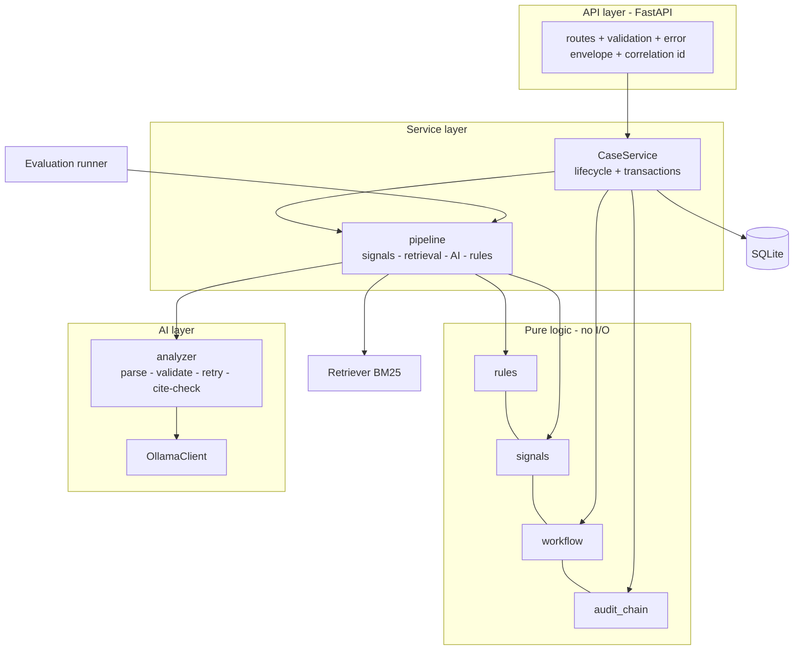
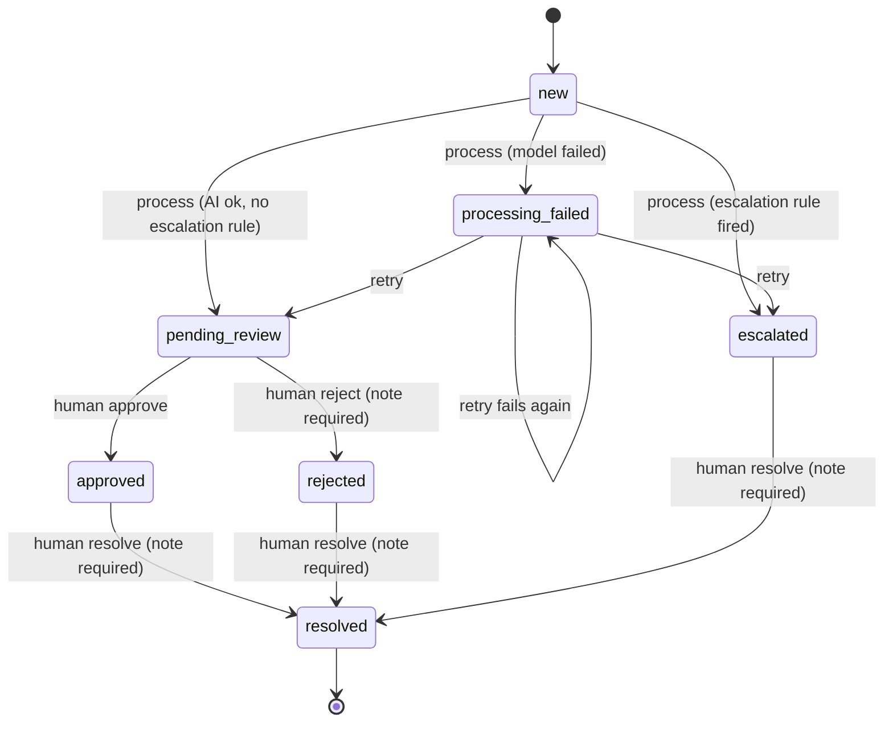

# Design (Milestone 1)

## Problem
Acme Cloud (fictional, ~40 support staff) receives mixed-quality support messages. Staff spend time reading, categorising, looking up policy and deciding what is urgent. We want a system that does the first pass reliably and visibly, while keeping people in charge of anything that moves money or changes an account.

## Scope: the smallest credible implementation
Four categories (`billing`, `account_access`, `technical`, `other`), three priorities, keyword retrieval over 13 short policy files, five core tables, and an evaluation script. **Deferred on purpose:** dashboard, embeddings, Docker, PostgreSQL, hosted deployment, real authentication.

## Components

The **evaluation runner calls the same `run_pipeline` function the API uses**, so the evaluation measures the real behaviour, not a copy of it.

## Division of responsibility

| Decision | Made by | Why |
|---|---|---|
| Category, sentiment, summary, draft reply, cited policy | LLM (suggestion) | Language understanding is what it is good at |
| Priority | Rules (`compute_priority`) | Must be explainable and consistent; the model's own "urgency" is advisory |
| Escalation | Rules + model signals | Security, legal, outage, repeat contact, injection, low confidence, missing/invented policy support always reach a human |
| Approve / reject / resolve | Human, server-side | AI output is never treated as approval |
| What happens when the model fails | Rules | Case becomes `processing_failed` (retryable), or `escalated` if keywords show risk |

### Priority policy v1
- **high**: security signal, legal threat, outage, repeat contact (2+), or double charge combined with a locked account
- **medium**: billing or account-access issues; technical issues with a problem keyword
- **low**: everything else

### Decision codes
`E_*` sends the case to a human: `E_SECURITY_SIGNAL`, `E_LEGAL_SIGNAL`, `E_OUTAGE_SIGNAL`, `E_REPEAT_CONTACT`, `E_INJECTION_SUSPECTED`, `E_AI_REQUESTED_ESCALATION`, `E_LOW_CONFIDENCE`, `E_FABRICATED_CITATION`, `E_NO_POLICY_SUPPORT`. `R_MODEL_FAILURE` marks a model failure. `N_KEYWORD_CATEGORY_MISMATCH` is informational.

## Case states and transitions

Approving a **consequential** case (refund, account unlock, security) needs a note of at least 10 characters. Refused operations are recorded as `request.denied` audit events.

## Data model (SQLite)
`cases` (status with CHECK constraint, category, priority, decision codes, idempotency key unique) · `ai_runs` (model, prompt version, attempts, latency, error category, validated analysis JSON, citations, output hash, correlation id; this is where the **recommendation** lives) · `approvals` (decision, reviewer, note) · `audit_events` (hash chain) · `eval_runs`.

## Audit
Each event stores `prev_hash` and `event_hash` (SHA-256 over every field including `prev_hash`). Events never contain the customer's message, only its hash and length. See `docs/security.md` for what this does and does not prove.

## API contract
See the table in `README.md` and the live OpenAPI at `/docs`. Status codes: 200/201 success, 401 missing or wrong key, 404 unknown case, 409 invalid transition or idempotency conflict, 422 validation or missing note, 503 staff key not configured.

## Acceptance criteria
1. Creating a case twice with the same `Idempotency-Key` and body returns the same case; a different body with the same key is a 409. *(tested)*
2. A malformed or unavailable model never causes a 500; the case becomes `processing_failed` and the failure is audited. *(tested)*
3. A recommendation that cites a source that was not retrieved is escalated. *(tested)*
4. No code path other than the human endpoints can set `approved`, `rejected` or `resolved`. *(tested)*
5. A refund/unlock approval without a real note is refused and the refusal is audited. *(tested)*
6. Editing or deleting a middle audit event makes `/audit/verify` fail. *(tested)*
7. A message that tries to override instructions is escalated even if the model obeys it. *(tested)*
8. Security, legal, outage and repeat-contact messages reach a human even when the model is down. *(tested)*
9. The evaluation can be re-run with one command and reports validity, accuracy, grounding, failure rate and latency. *(implemented; first real-model run is yours to do)*
10. The test suite runs with no Ollama and no internet. *(tested)*

## Decisions and trade-offs
- **Plain `sqlite3` instead of SQLAlchemy.** Five tables are easy to read as SQL, there is nothing extra to install, and the whole persistence layer could be tested directly. The cost: a PostgreSQL move needs the queries rewritten, or SQLAlchemy introduced at that point.
- **BM25 keyword retrieval before embeddings.** Free, explainable, instant. Known weakness is vocabulary mismatch; the evaluation reports retrieval hit rate so we know when embeddings are justified.
- **Rules own priority and escalation.** Slightly blunt, but auditable and unaffected by model drift or prompt injection.
- **Model call outside the database transaction.** A slow LLM must not hold a write lock; the status is re-checked when saving so two simultaneous `/process` calls cannot both win.
- **JSON schema passed to Ollama, with a plain-JSON fallback**, plus our own validation regardless; the model is never trusted to be well-formed.
- **Temperature 0** for repeatable evaluation runs.
